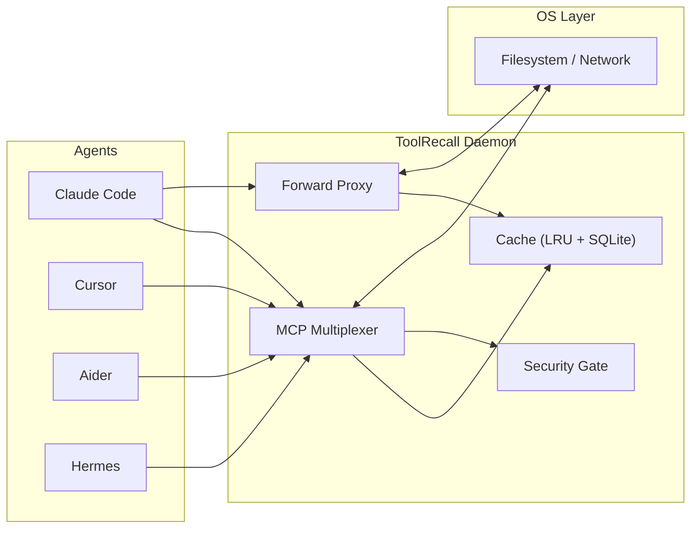

# ToolRecall — Deterministic Execution Layer for Agent Tools

**🌐 [toolrecall.dev](https://toolrecall.dev) — documentation, benchmarks, downloads**

You run agents. Every session spawns its own MCP servers, every test run hits live APIs, every tool call is unrepeatable, and your agent can read `~/.ssh` if it feels like it.

ToolRecall is one shared daemon that pools your MCP servers, records and replays tool results, caches repeated API calls, and enforces filesystem/terminal policy for any agent framework.

**−36% on a 450-turn session — verified with separate billed API keys, not estimates.** Additive to any model's prefix caching. Under 1MB install. Python 3.11+ stdlib only.

> **⚠️ Who this is for:** ToolRecall's file cache shines for **stateless agents** (Hermes, OpenCode, Cline, Google ADK) — agents with limited or no built-in context management. If your agent already manages its own context (Claude Code, Cursor, Codex CLI), the forward proxy and MCP multiplexer still save real money, but file caching through MCP may **increase** costs. See [Agent Compatibility](https://github.com/whiskybeer/toolrecall/blob/main/docs/AGENT_COMPATIBILITY.md).

```bash
pipx install toolrecall
toolrecall setup          # One-shot: config -> systemd -> daemon start
```

> **Zero config mode:** Every `toolrecall` command auto-starts the daemon if it isn't running. You never need to think about it.

---

## Why ToolRecall — stop paying for tokens you already saw

Two capabilities are the reason to run it. Both are measured, both target the same waste: your agent re-encountering content that's already in its context.

| Capability | What it does | Measured |
|-----------|--------------|----------|
| **Context Tracker** | Tells the agent which files it only *read* (vs edited) are safe to drop from its context window, so a long session stops growing larger every turn. By keeping your context small it helps **prefix and non-prefix models alike**. | **9.5× fewer request tokens per turn** and **7.4× longer sessions** before the context wall (read-only benchmark, prefix-caching model; real-session figure below) — [Context Tracker](#context-tracker) |
| **Input Dedup Hook** | Agents re-paste the same file contents into the message over and over. The hook spots a repeat and sends a short "same content as before" placeholder instead of the full copy again — you pay for each block once, and the model still sees it. Built into the forward proxy (`[forward_proxy] dedup`) or runnable as a LiteLLM gateway hook. | **−32.3% input tokens / −30% billed cost** on real coding tasks (SWE-bench Lite, billing-verified) — [Dedup Hook](#input-dedup-hook) |

---

## Quickstart — Forward Proxy (10 seconds, any agent)

Set one environment variable and all your agent's API calls route through the proxy. Cache hit = zero tokens billed.

```bash
export OPENAI_BASE_URL=http://localhost:8569/v1
# or for Anthropic-compatible agents:
export ANTHROPIC_BASE_URL=http://localhost:8569
```

That's it. Every identical API call across sessions costs $0. Works with any OpenAI/Anthropic-compatible agent — no per-agent config.

**What that saves (billed API keys, not estimates):**

| Workload | Without TR | With TR | Savings |
|----------|-----------|---------|---------|
| Bugfix (450 turns, both completed) | $8.83 | $5.62 | **−36%** |
| Review (200 turns, naive died at 112) | $2.53 | $1.26 | **−50%** |
| Analysis (400 turns, naive died at 145) | — | Completed | **full run** |

Separate OpenRouter keys per arm. Full methodology: [Benchmark](https://github.com/whiskybeer/toolrecall/blob/main/docs/BENCHMARK.md). No token estimates — only billed dollars from the provider dashboard.

See [Forward Proxy](https://github.com/whiskybeer/toolrecall/blob/main/docs/FORWARD_PROXY.md) for configuration and provider routing.

---

### Option B — MCP Bridge (for agents that support MCP)

If your agent uses MCP, register one server:

```json
{
  "mcpServers": {
    "toolrecall": {
      "command": "toolrecall",
      "args": ["mcp"]
    }
  }
}
```

```toml
# ~/.config/toolrecall/toolrecall.toml
[mcp_multiplex]
servers = ["time", "sequential-thinking", "cache-fs"]
```

Now every MCP-capable agent shares one warm pool of servers. No more N×M cold Node processes.

Features: lazy loading, idle timeout, failure isolation, auto-resolution. Since 0.8.21, every MCP bridge response carries a deterministic RFC 8785 (JCS) request key, so identical MCP calls are cache-identical across sessions — key ordering, whitespace, and numeric spelling drift cannot split the cache. See [MCP Multiplexer](https://github.com/whiskybeer/toolrecall/blob/main/docs/MCP_MULTIPLEXER.md).

---

## What ToolRecall Does

| Feature | What it solves |
|---------|---------------|
| **Forward API Proxy** | Cache API responses by body hash — hit = zero tokens billed. **−36% on 450-turn sessions (billed keys).** Additive to any provider's prefix caching. |
| **Context Tracker** | Track dirty/clean files, auto-hint agents what to drop from context. 9.5× fewer request tokens per turn, 7.4× longer sessions (read-only benchmark; ~11 % per-turn reduction in real mixed sessions). |
| **Input Dedup Hook** | Removes repeated file content before billing — **−32.3% prompt tokens / −30% cost on SWE-bench Lite (billing-verified).** Built into the forward proxy (`[forward_proxy] dedup = true`) or available as a LiteLLM gateway hook. |
| **Replay Mode** | Record agent sessions, replay deterministically in CI — 0.8.21 adds a fork tree (`replay tree` / `fork` / `at`): concurrent branches replay the shared tool-call prefix and re-execute only divergent calls, the substrate for the GEPA adapter |
| **Security Gate** | Path allowlist, terminal policy, sensitive-file blocklist — any agent |
| **MCP Multiplexer** | One shared pool of MCP servers instead of N processes per agent session — pays off with multiple agent sessions or agents without native MCP config; [when to skip](https://github.com/whiskybeer/toolrecall/blob/main/docs/MCP_MULTIPLEXER.md#when-the-multiplexer-is-and-isnt-worth-enabling) |
| **File / Terminal Cache** | Reduce redundant reads within a turn; bounded context growth for stateless agents without built-in context management |
| **Framework Adapters** | Drop-in wrappers for ADK, LangChain, LangGraph, herdr, Odysseus, LiteLLM, GEPA, Warp |

Full detail in [Architecture](https://github.com/whiskybeer/toolrecall/blob/main/docs/ARCHITECTURE.md).

---

## Verifying Your Hit Rate — `toolrecall trend`

> **TL;DR:** Lifetime hit rate is one number; your workload is a curve. `toolrecall trend` shows the daily hit rate and — crucially — *which path classes* are missing, so you can tell "cache is broken" from "this directory is never cacheable" and fix either honestly.

`toolrecall stats` shows cumulative counters since install. They average over every regime your workload has been through, so a 62% day and an 82% day become an invisible 71%. The trend view answers the question that actually matters: **how good is ToolRecall for my use case, right now, and where is it losing reads?**

```console
$ toolrecall trend
  ToolRecall Hit-Rate Trend (daily, from access_log)
  =====================================================
  coverage: 2026-09-07 05:32 → 2026-09-08 12:36 (50000/50000 window entries)

  date        reads   hits  misses  hit%
  ------------------------------------------
  2026-09-07   30399   18744   11655   61.7
  2026-09-08   19599   14143    5456   72.2

  Worst hit-rate classes (min 100 reads in window):
  path_class                                             reads    share   hit%
  ------------------------------------------------------------------------
  /home/u/.hermes/webui                              14315   28.6%   27.9
  /home/u/.hermes/cron                                9163   18.3%   34.9
  /home/u/docs                                        2211    4.4%   91.7
```

### Reading the output

- **Daily table** — hit% per day. A falling or flat-lined rate is a signal; a rising one after a config change confirms the change worked.
- **Worst classes** — path classes (directory level) with the lowest hit rates, ≥100 reads each. The two numbers to weigh together:
  - **share%** — how much of your traffic this class is. A 5% class missing 90% of its reads costs little; a 28% class missing 72% caps your whole rate.
  - **hit%** — persistently low usually means the class is *rewritten on every access* (session transcripts, logs, generated files). Those reads can never hit by construction.

### Acting on it

If a high-share class is rewritten every access, pin it to never-cache so it exits the miss accounting instead of polluting it:

```toml
# ~/.config/toolrecall/toolrecall.toml
[cache]
file_ttls = { "~/.hermes/webui/sessions/*" = 0 }
```

`ttl = 0` = serve-through: every read is honest (fresh from disk), and the class stops counting as misses — your headline hit rate reflects only what the cache *can* do. If instead the class has stable files and still misses (low hit% on low-churn content), that is a real cache bug — please [open an issue](https://github.com/nousresearch/toolrecall/issues).

### Notes

- **Data source / retention:** computed at query time from the `access_log` rolling window (~50k reads). No rollup tables, nothing scheduled, no extra state. Old days roll out of the window as new reads push them out — the trend is a *recent* view by design.
- **Read-only, daemon-free:** the CLI opens the cache DB read-only (WAL-safe); it neither needs nor touches the running daemon.
- **`--json`** for scripting/observers: `{"trend": [...], "miss_classes": [...], "coverage": {...}}`.
- **`--days N`** limits the daily table to the most recent N days (default 7).

---

## Context Tracker

> **TL;DR:** ToolRecall caches file reads so re-reading is instant (~0.1ms). The Context Tracker adds **dirty-file awareness**: the agent drops old file content from its context window and re-reads on demand from cache — keeping context bounded and breaking the O(n²) attention-cost snowball.

Every turn, an agent appends all prior tool output to its history, and the LLM computes attention over the whole sequence — **O(n²) in tokens**. ToolRecall caches the *I/O* but not the *context window*; without help, file content the agent read ten turns ago still sits in context as redundant overhead.

The Context Tracker records which files were **written** (made *dirty*) since a user-defined checkpoint. Clean files (read but not modified) are safe to drop: a cache hit returns the same content in ~0.1ms, so dropping costs nothing.

| Category | Meaning | Agent action |
|----------|---------|--------------|
| **Dirty** | Modified by the agent since checkpoint | **Keep** — uncommitted work |
| **Clean** | Read but not modified | **Drop from context**, re-read from cache if needed |
| **Untracked** | Never read | Not in context — no action |

**Available in the MCP Bridge as five tools** — `context_set_checkpoint`, `context_get_dirty`, `context_get_stats`, `context_reset`, `context_get_hint`. The bridge **auto-appends a drop hint to tool responses after the agent's first `context_set_checkpoint` call** (checkpoint opt-in), telling it which clean files to drop — agents that never checkpoint (e.g. Claude Code) see no hint text. No agent-side config is required beyond the pattern.

**Measured, not modeled.** On real runs (Hermes agent, DeepSeek V4 Flash — a model with prefix caching already on), the tracker sent **9.5× fewer request tokens per turn** (8,077 vs 76,430 at turn 10) and the session ran **7.4× longer** (140 vs 19 turns) before hitting the context wall. Because it shrinks the context window itself — not just what the provider caches — the benefit holds for **prefix and non-prefix models alike**.

**What that means in ordinary sessions.** The 9.5×/7.4× above is the **read-only best case** — 4 files re-read in a loop, no writes, no harness-side compaction. Across **240 real mixed sessions (48,125 turns)**, unchanged clean file content is **~11 % of the per-turn input** (median; 11.7 % by bytes), and the share **shrinks as sessions get longer** (<50 turns ≈ 22 %, ≥400 turns ≈ 9 %). So in real usage the tracker is a **~10–15 % per-turn context reduction that delays compaction**, not a 7× endurance multiplier.

How far it goes depends on the workload: an agent that rewrites whole files every turn saves less than one that re-reads the same files. The table below is the **modeled ceiling** — it assumes an idealized re-read-heavy agent that drops every clean file each turn (~7 files/turn):

| Agents × Turns | Baseline (attention pairs) | With Tracker (every-turn drops) | Reduction |
|:---:|:---:|:---:|:---:|
| 1 × 30 | 1.27T | 127B | **90%** |
| 5 × 30 | 6.35T | 635B | **90%** |
| 10 × 30 | 12.7T | 1.27T | **90%** |
| 20 × 30 | 25.4T | 2.54T | **90%** |
| 10 × 100 | 171T | 4.23T | **97.5%** |

**Read this number carefully:** the ~90% (up to 97.5%) is a **modeled upper bound** for an idealized re-read-heavy session — **not** a measured benchmark. The measured headline is the **9.5× fewer tokens / 7.4× longer endurance** above. Two caveats hold either way: the daemon can't *force* the agent to drop — it provides the data, the agent must act on it — and append-only harnesses (Claude Code, Cursor) can't use the tracker at all. See [Agent Compatibility](https://github.com/whiskybeer/toolrecall/blob/main/docs/AGENT_COMPATIBILITY.md).

Full detail: [Context Tracker](https://github.com/whiskybeer/toolrecall/blob/main/docs/CONTEXT_TRACKER.md) · [Agent integration](https://github.com/whiskybeer/toolrecall/blob/main/docs/AGENTS.md) · [Stale-file detection](https://github.com/whiskybeer/toolrecall/blob/main/docs/CONTEXT_STALE.md)

---

## Recall Tier *(opt-in, experimental)*

> **TL;DR:** Keep only a pointer to output you probably won't need; restore it on the rare turn you're wrong.

Most blocks an agent sees are reproducible — a file at a path, a command, an API call keyed by request hash. Re-reading is byte-identical, so dropping the content is free. **Non-reproducible** content — a one-shot API response, a live web snapshot, ephemeral tool output that would never come back identical — can't be re-fetched, so it has historically been forced to sit in the context window at full token cost, every turn, just in case it's needed again.

The Recall Tier lets an agent do something else entirely: **evict it by default, restore on demand.** It works like a scratchpad that's always there but only billed when opened:

1. **`recall_store`** persists the raw content out-of-band and returns a tiny deterministic **`node_id`** pointer.
2. The agent keeps **only** the pointer in context.
3. **`recall_get(node_id)`** restores the raw bytes **on demand** — the exact lossless-recoverable eviction contract the Context Tracker already gives reproducible files, extended to the non-reproducible tail.

**How this is different from a cache hit.** A cache hit *avoids* an LLM round-trip; a `recall_get` *is* one, because it re-inserts the bytes. The win is never in the turn you call `get` — it's in all the turns you don't have to. A 10k-token block stored on turn 5 and never re-read costs 0 for the remaining 195 turns of a 200-turn task instead of 1.95M token-turns of sitting in context.

### When to use it (and when not to)

| Use it when… | Don't bother when… |
|---|---|
| The block is a non-reproducible one-shot (web/API response, ephemeral output) | Content that is reproducible — the normal cache already handles it, losslessly |
| You need to bound context size but can't depend on a re-fetch | You'll definitely need the block again soon (eviction is only worth it if eviction usually stands) |
| The pointer is meaningfully smaller than the content | The content is tiny to begin with |

The feature is off by default and adds **zero runtime dependencies**. Enable with `[recall].enabled = true` (or `TOOLRECALL_RECALL_ENABLED=true`). The default TTL is **0 = never expire** — set `[recall].ttl` (or `TOOLRECALL_RECALL_TTL`) in seconds to bound how long entries live. Expired entries are treated as cache misses, purged lazily on read, and swept from disk by the regular GC cycle; they are never returned and never count as cached.

> **Status: experimental.** The tier works and is tested (roundtrip, dedup, TTL expiry, lazy purge, GC sweep), but it is not yet driven by any first-party shim or adapter — no agent calls `recall_store` automatically today. You opt into it explicitly (via CLI or MCP) or not at all. See [docs/RECALL_TIER.md](https://github.com/whiskybeer/toolrecall/blob/main/docs/RECALL_TIER.md) for the contract.

### Accounting and honesty

Every `recall_get` hit records the entry's token count in a dedicated `recall` sink in `cache_status`, tracked separately from file-cache hits. **This is a "bytes served" counter, not a savings claim.** It means "this much content was restored via the recall tier" — useful for understanding what the pool is doing, not a number that belongs in a cost-savings banner. Real savings from eviction-only use (never restoring) are invisible to accounting by definition: the win is that the context window stayed small, and there's nothing to count.

Full detail: [Recall Tier](https://github.com/whiskybeer/toolrecall/blob/main/docs/RECALL_TIER.md)

---

## Input Dedup Hook

> **TL;DR:** AI agents re-read the same files over and over, and every read pastes that file into the message they send to the model. This hook removes the repeated copies before they're billed — cutting input tokens with cost measured, not estimated.

**Why this matters, in plain English.** When an agent works on a task it re-reads the same files many times, and each read sends that file's contents to the model again. On a long session the same file can be sent five, ten, twenty times — and normal billing charges you for *every* copy. The hook keeps the **first** copy (so the model still has the information, and the provider's own caching stays intact) and turns every later repeat into a short note like *"same content as before — see message 4."* You pay for each block once, not once per read. How much you save depends on your agent: one that re-reads the same files a lot saves the most.

| Metric (80 req/arm, SWE-bench Lite × 8 turns) | WITH dedup | WITHOUT dedup | Saved |
|---|---|---|---|
| **Total prompt tokens** | 282,688 | 417,256 | **134,568 (−32.3%)** |
| **Billed cost (OpenRouter)** | $0.0134 | $0.0191 | **$0.0057 (−30.0%)** |

**Prefix caching preserved.** Effective per-token rate is near-identical between arms (Δ $0.0015/M) — the keep-first design stubs only *later* duplicates, so each block's first occurrence is byte-identical to the non-dedup arm. The honest shape of the method: it saves on *re-reads* (savings appear from turn 4, growing to **−49.9%** by turn 8), not first reads.

**Honesty (stated explicitly):** token savings are **billing-verified**; **task-quality is not**. A SWE-bench pass@1 A/B was attempted but inconclusive (the baseline model scored 0 on the chosen tasks even in isolation), so the defensible claim is: *"the hook removes wasted input tokens; its effect on task success is unverified."* Savings are also workload-dependent — an agent that rewrites whole files each turn saves less.

**Zero-trust customer triage:** `bench/litellm_dedup/measure_duplicates.py` measures *your own* duplicate ratio from a JSONL export of your request bodies, entirely inside your perimeter, no network, no API key — so you know what you'd save before any pilot. It reports volume stubbable, deliberately *not* billed-$, because real savings depend on prefix-cache economics.

**Two ways to run it** — same algorithm (`toolrecall.dedup`), same knobs (`TOOLRECALL_DEDUP_MIN_CHARS`/`_PROTECT_LAST`/`_MEDIA`), same `X-ToolRecall-No-Dedup` opt-out semantics:

| | Built-in proxy dedup | LiteLLM gateway hook |
|---|---|---|
| Where | ToolRecall's own forward proxy (`:8569`) — the one your `base_url` already points at | A separate [LiteLLM Proxy](https://docs.litellm.ai/docs/proxy/quick_start) in front of the provider |
| Enable | `[forward_proxy] dedup = true` (or env `TOOLRECALL_FORWARD_DEDUP=1`), restart daemon | `litellm_settings: callbacks: toolrecall.adapters.litellm.handler` in LiteLLM's `proxy_config.yaml` |
| Streaming requests | ✅ rewritten before the stream relay | ⚠️ LiteLLM bypasses `async_pre_call_hook` on some paths (see adapter docstring) |
| Extra process | none | LiteLLM Proxy |

The built-in path was verified end-to-end against live OpenRouter billing through `:8569`: a two-turn conversation re-pasting a ~1,141-token tool result billed 1,245 prompt tokens on turn 2 with dedup vs 2,217+ without — turn 2's *billed cost* stayed ≈ turn 1's because the keep-first prefix remains byte-identical to provider prompt caching.

Full benchmark & methodology: [LiteLLM Dedup Benchmark](https://github.com/whiskybeer/toolrecall/blob/main/bench/litellm_dedup/README.md) · ready-to-use config: [litellm-proxy-config.yaml](https://github.com/whiskybeer/toolrecall/blob/main/docs/examples/litellm-proxy-config.yaml)

---

## How It Works



One daemon, five access paths: Python client, MCP bridge, HTTP bridge, forward proxy, OS-level shim. All share one cache, one security gate, one multiplexer. See [Architecture](https://github.com/whiskybeer/toolrecall/blob/main/docs/ARCHITECTURE.md).

---

## When To Use It

| You want this... | Use this... | Works for |
|-----------------|-------------|-----------|
| $0 dev loops — repeated API calls cost nothing | Forward Proxy | Any agent |
| Lower per-turn cost on long agent sessions | Context Tracker | Stateless agents (Hermes, Cline, ADK) |
| Cached file reads, lower context bloat | File / Terminal Cache | Stateless agents — bounded context growth. **Not** for agents with built-in context management (Claude Code, Cursor, Codex CLI) |
| Deterministic CI tests for agent behavior | Replay Mode | Any agent |
| Guardrails between agents and your machine | Security Gate | Any agent |
| Warm MCP servers across sessions | MCP Multiplexer | Multi-session hosts; agents without native MCP config |
| One warm cache for a whole team | Network Daemon (A6) | Any agent over TCP+TLS |
| All of the above | `toolrecall setup` then add the MCP bridge | See per-agent notes |

---

## Installation

### One-time setup

```bash
pipx install toolrecall        # or: uv tool install toolrecall
                               # or: pip install toolrecall (inside a venv)
toolrecall setup                # config -> systemd service -> daemon start
```

> **PATH check:** After installation, make sure `toolrecall` is on your `$PATH`.  
> `pipx` puts binaries in `~/.local/bin/`, `uv tool install` in `~/.local/share/uv/tools/`.  
> If `toolrecall` isn't found, add the right directory to your PATH or reinstall inside the venv your agent uses.

> **Shim in the right venv:** `toolrecall shim --install` installs the `.pth` shim into the
> **current Python environment**. If you installed via `pipx` or `uv tool install`, the
> shim goes into that isolated environment — not your agent's venv. The agent won't see it.
> `toolrecall setup` auto-detects common agent venvs and installs the shim there too.
> `toolrecall shim --install --all` scans for agent venvs (Hermes, OpenCode) and installs
> into all of them at once.
> If you need to target a specific venv manually:
> ```bash
> toolrecall shim --install --venv ~/.hermes/hermes-agent/venv
> toolrecall shim --install --venv ~/.local/share/uv/tools/hermes-agent
> ```
> The `toolrecall` package must also be installed in that venv (`import toolrecall` must work).

**Agent type → mechanism:** pick based on what your agent is:

| Agent type | Mechanism | Needs `toolrecall` in the venv? | Setup action |
|---|---|---|---|
| Python agent, own venv (Hermes, Codex, OpenCode, Cline) | `.pth` shim in the agent venv (transparent `open()`/`subprocess` cache) | yes | `toolrecall shim --install --venv <path>` (opt-in) |
| Non-Python agent (Claude Code, Cursor, Cline, Windsurf) | MCP bridge (`toolrecall mcp`) | n/a | register an MCP server |
| System python / global interpreter | shim in user site-packages | yes | `toolrecall shim --install` |

> The `.pth` shim is **opt-in, default off** — `toolrecall shim --install` or
> `--venv`/`--all` prompts before enabling. Use `--yes` to skip the prompt.
> Verify with `toolrecall shim --status [--all]` (prints `probe: pass` only when
> the shim actually imports in that venv from a neutral cwd).

`toolrecall setup` creates `~/.config/toolrecall/toolrecall.toml` with default-deny security, generates a systemd user unit, and starts the daemon. After this, every `toolrecall` command "just works".

Daemon auto-start fallback: systemd -> os.fork() -> DETACHED_PROCESS (Linux -> Docker/macOS -> Windows).

### Per-agent integration

| Method | How | When to use |
|--------|-----|-------------|
| **MCP Bridge** | `toolrecall mcp` in agent's MCP config | Any MCP-capable agent (recommended) |
| **Go Client (tr)** | `tr read file.py`, `tr term "hostname"` | Shell scripts, CI, any language |
| **Python Shim** | `toolrecall shim --install` | Every Python process auto-caches open/subprocess |
| **Python Client** | `from toolrecall.client import cached_read` | Direct embedding in Python code |
| **HTTP Bridge** | `toolrecall debug` on :8570 (`/read?path=` `/term?cmd=` `/stats` `/health`) | Minimal demo/testing endpoint; for production use the MCP bridge or `tr` |
| **Forward Proxy** | Set `OPENAI_BASE_URL=http://localhost:8569/v1` | Cache API responses, zero tokens on hit |

### Extra storage backends

```bash
pip install toolrecall[libsql]       # libSQL local backend
pip install toolrecall[libsql-sync]  # libSQL + Turso Cloud sync
```

---

## CLI Quick Reference

```
toolrecall setup          One-shot: config + systemd + daemon start  [required once]
toolrecall daemon         Start daemon: cache + MCP bridge + forward proxy :8569
toolrecall status         Cache status and stats                     [auto-starts]
toolrecall stats          Detailed cache statistics (JSON)           [auto-starts]
toolrecall trend          Daily hit-rate trend + worst miss classes  [no daemon]
toolrecall trend --json   Machine-readable trend (observer/CI)       [no daemon]
toolrecall top            Interactive TUI dashboard: stats, access log, trend, tracker
toolrecall invalidate     Clear agent caches (api_cache: scope=api)  [auto-starts]
toolrecall reset-stats    Reset counters (hits, misses, tokens) without clearing entries
toolrecall mcp            Start MCP Bridge                           [auto-starts]
toolrecall serve          Forward proxy — daemon already owns :8569; standalone on another port:
toolrecall serve --port 9090   Standalone forward proxy on :9090 (daemon must be stopped)
toolrecall replay         Record/replay agent sessions; tree|fork|at for fork-tree branches
toolrecall shim --install [--venv <path>|--all]  Install OS-level cache shim (.pth) — opt-in
toolrecall shim --status [--venv <path>|--all]   Check shim presence + import probe
toolrecall shim --uninstall [--venv <path>|--all] Remove .pth shim
toolrecall turso          Turso Cloud sync: init, enable, disable, status
toolrecall init           Create default config.toml and .env
toolrecall config-set     Set a config value
toolrecall context        Inspect Context Tracker / Recall Tier        [auto-starts]
toolrecall index          Index knowledge DB (FTS5 search)  [not file cache pre-warm]
toolrecall index-memory   Index agent memory stores
toolrecall index-dir      Index a directory for FTS5 search [not file cache pre-warm]
toolrecall index-compact  Rebuild FTS index + VACUUM (reclaim knowledge-DB bloat)
toolrecall proxy          Attach/detach Hermes' LLM traffic to the forward proxy (billed-savings path)
toolrecall healthcheck    Daemon/cache healthcheck — exit 0 healthy, 1 down/abnormal, 2 hard failure
toolrecall logs [--tail N] [--level X]   Inspect the rotating log rail
toolrecall update         Self-update from a pinned package index ([update].index_url)
toolrecall nginx          Generate nginx reverse-proxy config (~/.toolrecall/nginx-toolrecall.conf)
toolrecall debug          Minimal HTTP demo server on :8570 (/read /term /stats /health)
toolrecall restart        Health-checked systemd restart (config check → restart → verify)
toolrecall stop           Stop the daemon and revert agent proxy base-URL wiring
```

> **Knowledge indexing ≠ cache warming:** `toolrecall index*` commands build an FTS5 search index for knowledge retrieval (`docs_search()`). They do NOT pre-warm the file/terminal/API response cache. The daemon's file cache warms naturally as the agent reads files — no separate command needed.

Full reference: [CLI.md](https://github.com/whiskybeer/toolrecall/blob/main/docs/CLI.md)

---

## Configuration

```toml
# ~/.config/toolrecall/toolrecall.toml
[mcp]
allowed_paths = ["~/projects"]  # Default-deny! Shipped default: ["~/projects", "~/.hermes/skills"]
allow_terminal = false

[cache]
terminal_default_ttl = 300

[mcp_multiplex]
enabled = true
servers = ["time", "github", "sequential-thinking"]

[recall]
enabled = false   # opt-in Recall Tier (lossless-recoverable eviction)

[tracker]
# 0.8.21: checkpoint/dirty/clean state survives daemon restarts (default 6h, 0 = off)
persist_ttl = 21600
# ignore_read_prefixes = []   # paths never counted as agent context reads

[security]
# F1: strict realpath-only containment by default; lexical symlink rescue
# is opt-in (Windows junction attacks against Layer B are easiest)
allow_symlink_escapes = false

[update]
# F2: self-update pinned to ONE index (default official PyPI) — pip can't discover extras
enabled = true
check_interval_hours = 24
# Announce-only default: a newer release is printed at CLI entry and surfaced
# to your agent via tool-output hints — never installed silently. Install with
# `toolrecall update`, or set auto_apply = true to restore install-on-detect.
auto_apply = false
# index_url = ""   # e.g. an internal mirror; > TOOLRECALL_UPDATE_INDEX_URL > PyPI

[network]
# A6: shared team daemon — OFF by default. Daemon host:
enabled = false          # true starts a TCP listener alongside UDS
bind = "127.0.0.1"       # non-loopback ONLY behind VPN + tls=true
port = 8570
# token: TOOLRECALL_NETWORK_TOKEN env preferred (never commit it)
# openssl rand -hex 32   # generate with this
# tls = true             # REQUIRED outside loopback/VPN (HMAC ≠ encryption)
# tls_cert = "/etc/toolrecall/cert.pem"
# tls_key = "/etc/toolrecall/key.pem"    # chmod 600

# Team members connect with:
#   TOOLRECALL_TRANSPORT=tcp://daemon-host:8570
#   TOOLRECALL_NETWORK_TOKEN=<same token>
#   TOOLRECALL_NETWORK_TLS=true
#   TOOLRECALL_NETWORK_TLS_CA=/path/to/daemon-cert.pem   # pin + verify
#
# Remote callers are default-deny: scope each token-id, or they get
# nothing (see SECURITY.md §9):
# [network.clients.network-client]
# allowed_paths = ["/srv/projects"]
# allow_terminal = false

[forward_proxy]
# Starts on :8569 automatically with the daemon
# dedup = true   # 0.8.21: strip duplicate file-content blocks pre-billing (−32.3% on SWE-bench Lite)
```

`TOOLRECALL_*` env vars override TOML. Full reference: [Configuration Reference](https://github.com/whiskybeer/toolrecall/blob/main/docs/CONFIG_REFERENCE.md)

---

## Platform Support

| Platform | Transport | Status |
|----------|-----------|--------|
| **Linux** | Unix Domain Sockets | Tested in CI |
| **macOS** | Unix Domain Sockets | Should work (POSIX) |
| **Windows** | TCP localhost:8568 | Experimental |

---

## Documentation

- **[toolrecall.dev](https://toolrecall.dev)** — documentation portal, benchmarks, downloads
- [Architecture](https://github.com/whiskybeer/toolrecall/blob/main/docs/ARCHITECTURE.md) — system design, components, data flow, token costs
- [MCP Multiplexer](https://github.com/whiskybeer/toolrecall/blob/main/docs/MCP_MULTIPLEXER.md) — daemon-managed MCP server pool
- [Forward Proxy](https://github.com/whiskybeer/toolrecall/blob/main/docs/FORWARD_PROXY.md) — API response caching, provider list, auth routing
- [Replay Mode](https://github.com/whiskybeer/toolrecall/blob/main/docs/REPLAY_MODE.md) — record/replay tool calls for deterministic CI
- [Security Architecture](https://github.com/whiskybeer/toolrecall/blob/main/SECURITY.md) — policy gate, trust boundary
- [Agent Compatibility](https://github.com/whiskybeer/toolrecall/blob/main/docs/AGENT_COMPATIBILITY.md) — per-agent value, config, caveats
- [Benchmark](https://github.com/whiskybeer/toolrecall/blob/main/docs/BENCHMARK.md) — three-arm controlled measurement (naive vs prefix vs toolrecall), context efficiency, billed cost
- [LiteLLM Dedup Benchmark](https://github.com/whiskybeer/toolrecall/blob/main/bench/litellm_dedup/README.md) — gateway dedup hook: −32.3% prompt tokens / −30% cost, billing-verified
- [LiteLLM Proxy Example Config](https://github.com/whiskybeer/toolrecall/blob/main/docs/examples/litellm-proxy-config.yaml) — ready-to-use `litellm_settings.callbacks` hook wiring
- [Go Dedup Reference](https://github.com/whiskybeer/toolrecall/blob/main/go/dedup/README.md) — pure-Go request-level `dedup_messages` reference implementation
- [Bench Infrastructure](https://github.com/whiskybeer/toolrecall/blob/main/bench/README.md) — reproduce the three-arm benchmark
- [Test Suite](https://github.com/whiskybeer/toolrecall/blob/main/tests/README.md) — test runner documentation
- [CLI Reference](https://github.com/whiskybeer/toolrecall/blob/main/docs/CLI.md) — all subcommands
- [Configuration Reference](https://github.com/whiskybeer/toolrecall/blob/main/docs/CONFIG_REFERENCE.md) — config.toml, env vars
- [Context Stale](https://github.com/whiskybeer/toolrecall/blob/main/docs/CONTEXT_STALE.md) — provably stale files in agent conversations
- [Context Tracker](https://github.com/whiskybeer/toolrecall/blob/main/docs/CONTEXT_TRACKER.md) — checkpoint-based dirty-file tracking
- [AGENTS.md](https://github.com/whiskybeer/toolrecall/blob/main/docs/AGENTS.md) — agent instructions for MCP context tracker integration
- [Recall Tier](https://github.com/whiskybeer/toolrecall/blob/main/docs/RECALL_TIER.md) — opt-in lossless-recoverable eviction for non-reproducible content
- [Testing Guide](https://github.com/whiskybeer/toolrecall/blob/main/docs/TESTING.md) — test philosophy, per-file coverage
- [How It Works](https://github.com/whiskybeer/toolrecall/blob/main/docs/HOW_IT_WORKS.md) — quick technical overview
- [libSQL Backend](https://github.com/whiskybeer/toolrecall/blob/main/docs/LIBSQL_COMPARISON.md) — multi-writer, vector search, cloud sync
- [Docker Deployment](https://github.com/whiskybeer/toolrecall/blob/main/docs/DOCKER.md) — containerized stack
- [Troubleshooting](https://github.com/whiskybeer/toolrecall/blob/main/docs/TROUBLESHOOTING.md) — common fixes
- [Changelog](https://github.com/whiskybeer/toolrecall/blob/main/CHANGELOG.md) — version history
- [Cost Savings](https://github.com/whiskybeer/toolrecall/blob/main/docs/COST_SAVINGS.md) — why savings are model/provider-agnostic
- [Resilience](https://github.com/whiskybeer/toolrecall/blob/main/docs/RESILIENCE.md) — coalescing, retry, circuit breaker (`toolrecall/resilience.py`)
- [Tree Search](https://github.com/whiskybeer/toolrecall/blob/main/docs/TREE_SEARCH.md) — tree search over agent executions: cost model, phased contract, GEPA integration
- [Go Client](https://github.com/whiskybeer/toolrecall/blob/main/go-client/README.md) — standalone `tr` binary for any language/shell
- [Agent Configs](https://github.com/whiskybeer/toolrecall/blob/main/configs/README.md) — ready-to-use MCP configs for popular agents
- **Framework Adapters:**
  - [Google ADK](https://github.com/whiskybeer/toolrecall/blob/main/docs/google-adk.md) — `@cached_tool` decorator + forward proxy
  - [LangChain / LangGraph](https://github.com/whiskybeer/toolrecall/blob/main/docs/langchain.md) — `ToolRecallCache` BaseCache + callback
  - [LangGraph Checkpointing](https://github.com/whiskybeer/toolrecall/blob/main/docs/langgraph-adapter.md) — `BaseCheckpointSaver` + `@cached_tool` for nodes; fork/resume for tree-search agents
  - [herdr](https://github.com/whiskybeer/toolrecall/blob/main/docs/herdr.md) — `tr` binary + MCP bridge for any pane
  - [Odysseus](https://github.com/whiskybeer/toolrecall/blob/main/docs/odysseus.md) — `cached_tool` decorator + MCP server caching
  - [LiteLLM Dedup Hook](https://github.com/whiskybeer/toolrecall/blob/main/bench/litellm_dedup/README.md) — gateway dedup callback (see benchmark entry above)
  - [GEPA](https://github.com/whiskybeer/toolrecall/blob/main/docs/TREE_SEARCH.md) — prompt-optimizer `evaluate` adapter over the replay fork tree; billed A/B: `bench/results/GEPA_FORK_AB_RESULTS.md` (79% saving, 25/25 byte-exact HIT replays)
  - Warp (`toolrecall.adapters.warp`) — routes Warp's custom inference endpoint through the forward proxy; canonicalization contract in [Canonicalization](https://github.com/whiskybeer/toolrecall/blob/main/docs/CANONICALIZATION.md)
- [Hermes Transparent Cache](https://github.com/whiskybeer/toolrecall/blob/main/docs/HERMES_TRANSPARENT_CACHE.md) — auto-patching for Hermes
- [Normalizer](https://github.com/whiskybeer/toolrecall/blob/main/docs/NORMALIZER.md) — cache key normalization, deterministic JSON
- [Canonicalization](https://github.com/whiskybeer/toolrecall/blob/main/docs/CANONICALIZATION.md) — request-body canonicalization (warp profile): volatile-field stripping for cross-session replay, experiment status + known risks
- [Knowledge DB](https://github.com/whiskybeer/toolrecall/blob/main/docs/KNOWLEDGE_DB.md) — FTS5 indexing guide
- [Real-Agent Benchmark](https://github.com/whiskybeer/toolrecall/blob/main/docs/REAL_AGENT_BENCHMARK.md) — edit-heavy session results
- [Appendix](https://github.com/whiskybeer/toolrecall/blob/main/docs/APPENDIX.md) — comparison tables, OSI model, ROI, audit

---

## Contributing

```bash
git clone https://github.com/whiskybeer/toolrecall.git
cd toolrecall
make setup    # one-time dev deps
make test     # run tests
make check    # lint + format
```

See [Testing Guide](https://github.com/whiskybeer/toolrecall/blob/main/docs/TESTING.md) and [Makefile](https://github.com/whiskybeer/toolrecall/blob/main/Makefile).

## Uninstall

```bash
systemctl --user stop toolrecall-daemon
systemctl --user disable toolrecall-daemon
pipx uninstall toolrecall
rm -rf ~/.toolrecall ~/.config/toolrecall
```